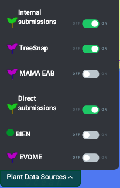
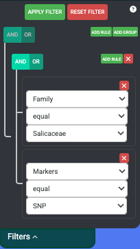
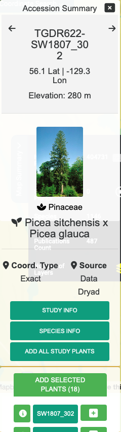
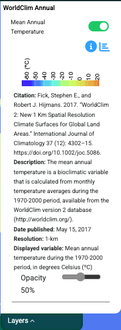
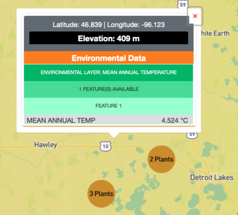
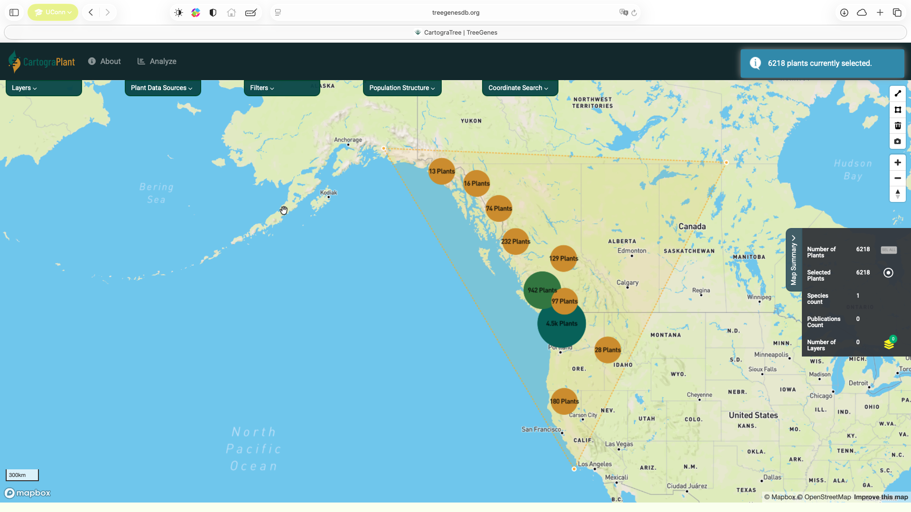
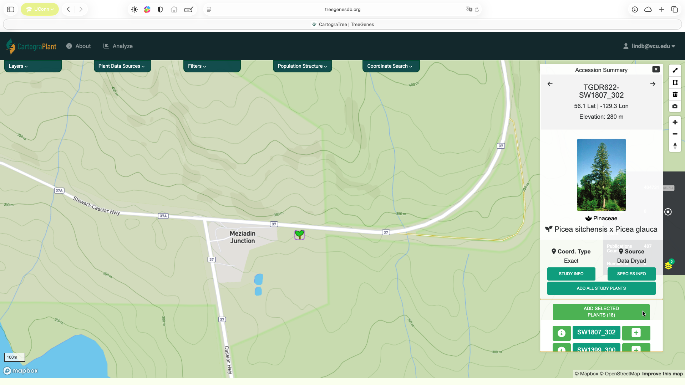
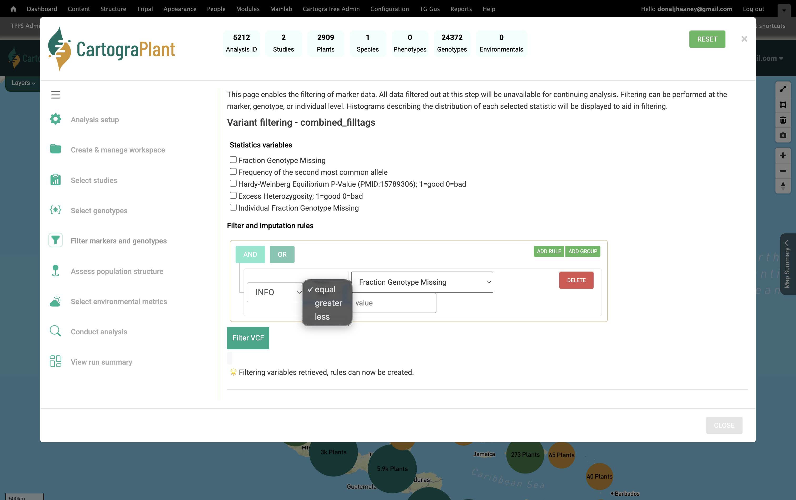
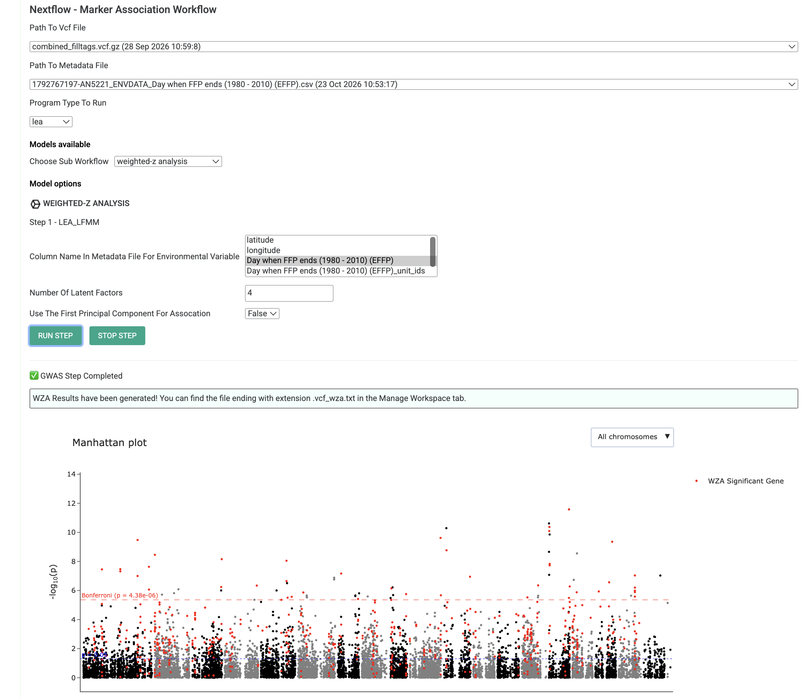

Users
==============

Cartograplant is a web application that allows users to visualize and analyze plant data from various sources, including TreeGenes, TreeSnap, and submitted studies. It provides an interactive map interface where users can select datasets, filter plants, and analyze phenotypic and genotypic data.

Basic User Interface
^^^^^^^^^^^^^^^^^^^^

.. raw:: html

    <video controls width="640" height="390">
        <source src="_static/cp_basic_user_interface.mp4" type="video/mp4">
        Your browser does not support the video tag.
    
    </video>

Select dataset sources to include
^^^^^^^^^^^^^^^^^^^^^^^^^^^^^^^^^

Cartograplant enables the analysis of plants from multiple data sources: Internal submissions, TreeGenes, Direct Submissions, TreeSnap, BIEN, Evome, MAMA EAB and WFID. The user can choose which plants from which datasets they want on the map, or any combination of them. When applying filters, only plants from selected datasets are effected.

To contribute and submit your own data for TreeGenes, you can use TPPS: https://treegenesdb.org/tpps. 
This is a module that streamlines the submission process for plant related studies.
The documentation for TPPS can be found here: https://tpps.readthedocs.io/

You can also contribute to TreeSnap by downloading the app and submitting pictures of the trees that you find: https://treesnap.org/.

Select and filter plants
^^^^^^^^^^^^^^^^^^^^^^^^^
Users can select plants to be included in an analysis from the left pane . Cartograplant has tens of thousands of plants, and it will only continue to grow. To only look at the plants of interest to you, you can filter the plants on the map by taxonomy, publication, genotype, and/or phenotype.

If you want to narrow your search even further, you can make use of the combination filters offered by the AND/OR switches and the ADD RULE and ADD GROUP buttons. Resetting the filter removes all currently active filters and shows all plants available on the map again.

    
The operation that is currently selected for each group is colored blue. The selection condition available for each property is EQUAL and NOT EQUAL. After clicking Apply Filters, the map should move to the area of interest where the filtered plants are located.

Hovering over a plant icon reveals how many plants there are at that location. Clicking on a plant icon opens an Accession Summary overlay located at the top right of the map. This overlay shows information about the currently selected plant and any images that are present for that plant. Clicking on the STUDY INFO button creates a popup which shows the publication, markers and phenotypes recorded for the plant.
At the bottom is a list of the plants located at this area. You can click on any of the plant IDs on the list to view information for that plant. There is also an + button which puts individual plants in the list of plants that will be part of the analysis, as well as button to ADD ALL STUDY PLANTS.

    
Filtering by passing parameters to URL
---------------------------------------
You can also filter the plants on load of the map by adding additional parameters to the URL.
The base URL for Cartograplant is: https://treegenesdb.org/Cartograplant
If a valid session has been provided then the URL is: https://treegenesdb.org/Cartograplant?session_id=<session_id>

The additional parameters that you can pass include TGDR study accession, species, genus, and family. Passing multiple of these parameters will result in a conjunction of the options.
An example filter by passing URL arguments is:
https://treegenesdb.org/Cartograplant?accession=TGDR002
https://treegenesdb.org/Cartograplant?species=Abies%20alba

Select environmental data
^^^^^^^^^^^^^^^^^^^^^^^^^
Users can also select the environmental values to be included in an analysis from the left pane by turning environmental layers on or off. The environmental layers are overlaid on top of each other, with the latest layer placed on top of previously selected layers. Clicking on any point on the map with at least one active layer will show the environmental values for that location.

Some enviornmental layers contain additional filters which will also be seen under the on/off toggle button. For example, range maps may have color options that allow you to color each range map as a way to differentiate between multiple selected layers. Some environmental layers contain a year range slider filter which allows you to filter between a starting year and ending year. For those that can filter by year, you will see a range slider in which the left select represents the starting year and the right select represents the ending year. Adjusting these sliders will filter the data in realtime.

Get location information
^^^^^^^^^^^^^^^^^^^^^^^^
Users can display the values at a particular location on the map by clicking on the map at that location. The pop-up window will display the plants present at that location, if there are any, and the values from the environmental layers selected.

When zoomed out, the plants are clustered and represented by circles. The color and size of the circle indicates how many plants there are in the cluster. The user can click on a cluster to zoom in and view the individual plants.

Navigation Controls
^^^^^^^^^^^^^^^^^^^
You can use arrow keys to move across the map, and the scroll wheel to zoom in. Double clicking on any point in the map will also zoom you in. Alternatively, there are navigation controls at the top right of the map which gives you control of the zoom level, the bearing, and the pitch of the map.

Analysis Panel
==============

Logged-in users have permission to perform landscape genomics analysis within the analysis panel.

About the Analysis Panel
^^^^^^^^^^^^^^^^^^^^^^^^

Within the map interface, select the dataset to be used, select/deselect specific plants, and choose which publications to include. 

Within the analysis panel, users can select the environmental layers to be used and the environmental variables to be included in the analysis for association. 
Analysis panels are broken up into key stages that represent a typical landscape genomics analysis:

#. Analysis setup
#. Create & manage workspace
#. Select studies
#. Filter traits
#. Select genotypes
#. Filter markers and genotypes
#. Assess population structure
#. Select environmental metrics
#. Conduct analysis
#. View run summary

The analysis panel leverages several Nextflow pipelines developed by TreeGenes to perform key steps in the landscape genomics workflow. The following table summarizes the key pipelines used in the analysis panel:

+-----------------------------------+--------------------------------------------------------------------+--------------------------------+------------------------------------------+
| Repository                        | Description                                                        | Primary Role in Analysis       | Technologies                             |
+===================================+====================================================================+================================+==========================================+
| `variant-filtering-pipeline`_     | VCF sample renaming, merging, statistics, and filtering            | VCF processing                 | Nextflow, bcftools, PostgreSQL           |
+-----------------------------------+--------------------------------------------------------------------+--------------------------------+------------------------------------------+
| `population-structure-pipeline`_  | Measures ancestral coefficients based on a model complexity K      | Population structure analysis  | Nextflow, PLINK, FastStructure           |
+-----------------------------------+--------------------------------------------------------------------+--------------------------------+------------------------------------------+
| `gwas-pipeline`_                  | Performs genome-wide association analysis using env or phenotype   | GWAS                           | Nextflow, PLINK, GEMMA, LEA              |
+-----------------------------------+--------------------------------------------------------------------+--------------------------------+------------------------------------------+

.. _variant-filtering-pipeline: https://gitlab.com/TreeGenes/variant-filtering-pipeline
.. _population-structure-pipeline: https://gitlab.com/TreeGenes/population-structure-pipeline
.. _gwas-pipeline: https://gitlab.com/TreeGenes/gwas-pipeline

Running an Analysis
^^^^^^^^^^^^^^^^^^^

1. `Login <https://treegenesdb.org/user>`_ to your account on TreeGenesDB.

2. Navigate to `CartograPlant <https://treegenesdb.org/Cartograplant>`_ and select the plants you want to include in the analysis. Users can select plants by using the polygon tool (top figure) or by adding all or a subset of plants related to a particular accession from the Accession Summary (bottom figure).

3. Click on **Analyze** at the top panel.

4. In the **Analysis setup** tab, you can select:
   
   - The kind of analysis to be performed

5. In the **Create & manage workspace** tab, users can create unique workspaces for different uses or analyses. Users can upload files for analyses, or download raw and filtered data as well as output files from analyses.

.. raw:: html

    <video controls width="640" height="390">
        <source src="_static/NATC-Workspace.mp4" type="video/mp4">
        Your browser does not support the video tag.
    
    </video>

In the **Select studies** tab you can select and unselect certain studies for further analysis based on sample size and contains genotype and/or phenotype data..

Once done, selected studies will authomatically be added to this analysis session to standardize the studies for merging.

.. raw:: html

    <video controls width="640" height="390">
        <source src="_static/NATC-StudyContext.mp4" type="video/mp4">
        Your browser does not support the video tag.
    
    </video>

In the **Filter traits** tab: you can select any traits that were phenotyped using the selected samples. This will create a file for each phenotype within the user workspace.

In the **Select genotypes** tab, you can select the set of markers that are common or unique to specific samples across selected studies. You can also select a genome version to remap SNPs to when merging selected studies.

In the **Filter markers & genotypes** panel, you can select statistics to visualize and apply combinations of filtering thresholds
   - Specifically, users can filter the combined genotypic data based on 1) the fraction of missing genotypes at a locus, 2) the frequency of the second-most common allele (e.g., the minor allele in SNP data), 3) p-value threshold for Hardy Weinberg equilibrium tests, 4) excess heterozygosity, and 5) the fraction of missing data at the individual level

In the **Assess population structure** panel, you can: 
   
   - quantify population structure through `fastSTRUCTURE <https://rajanil.github.io/fastStructure/>`_ analysis. fastSTRUCTURE uses a variational Bayesian approximation of the `STRUCTURE model <(https://web.stanford.edu/group/pritchardlab/structure.html>`_ to infer latent population structure from SNP genotypes, and its output allows you to estimate individual admixture proportions and determine the most likely number of ancestral populations (K) present in the dataset using software output which is saved to the user’s workspace.
   - select the input vcf from the workspace
   - number of ancestors (K) to run based off
   - parameters for linkage pruning by `plink <https://www.cog-genomics.org/plink/1.9/ld>`_
   - the pruned set of SNPs will be used as input to fastSTRUCTURE (this panel) and genotype-phenotype association analysis (see **Run Analysis** below)

.. raw:: html

    <video controls width="640" height="390">
        <source src="_static/NATC-PopulationStructure.mp4" type="video/mp4">
        Your browser does not support the video tag.
    
    </video>

.. note::
   The workflow will visualize only the run that has the lowest cross validation error.

In the **Select environmental metrics** tab, you can: 
    
    - select the environmental layers to include in further analysis (Genome-wide association)
    - measure the correlation between two or more environmental variables

.. raw:: html

    <video controls width="640" height="390">
        <source src="_static/NATC-EnvironmentalData.mov" type="video/mp4">
        Your browser does not support the video tag.
    
    </video>

In the **Conduct analysis** tab, provide a vcf and/or environmental file(s) generated from the **Select environmental metrics** tab or **Select Traits** tab to perform either genotype-phenotype or genotype-environment association analysis. Users can conduct genotype-phenotype analysis with two models from the `GEMMA software: <https://github.com/genetics-statistics/GEMMA>`_  a linear model, or a univariate linear mixed model. Users can conduct genotype-environment analysis using latent factor mixed models (LFMM) from the `LEA R package <https://www.bioconductor.org/packages/devel/bioc/vignettes/LEA/inst/doc/LEA.pdf>`_.” 
    

How can I see the code that was run? 
-------------------------------------

After completion of analysis and populations structure, users can view the code that was run for each workflow by downloading the **current-runcmds_populations_structure.txt** and **current-runcmds_gwas.txt** found in the workspace.

For example, the code run for GWAS using GEMMA linear model is as follows:

.. code-block:: bash

    plink \
    --vcf combined_filltags_filltags.vcf.gz \
    --make-bed --allow-extra-chr \
    --threads 6 \
    --out combined_filltags_filltags.vcf    

    plink \
        --bed combined_filltags_filltags.vcf.bed  \
        --bim combined_filltags_filltags.vcf.bim  \
        --fam combined_filltags_filltags.vcf.fam  \
        --threads 5 \
        --pheno pheno.tsv \
        --make-bed \
        --allow-extra-chr \
        --out combined_filltags_filltags.vcf_recode

    gemma \
        -bfile combined_filltags_filltags.vcf_recode \
        -lm 1 \
        -o combined_filltags_filltags.vcf_recode    

    gwas_vis.R \
        --assoc combined_filltags_filltags.vcf_recode.assoc.txt \
        --outprefix gwasVis \

.. note::
    It is expected that user has dependencies installed to run the code above or the necessary containers provided in the NextFlow modules. 

How long does it take?
----------------------
Selecting plant accessions from the map is quite efficient, and utilizes pre-loaded data to enable fast web responsiveness, including pre-loaded views of the database itself to reduce wait times. The data available on the map is one such example of pre-loaded data, and queries to environmental layers and associated metadata are expedited by efficient database queries.

In the Analysis Panel, filtering selected individuals and studies, selecting phenotypic data for analysis is also quite fast, enabled by similar pre-loaded data and efficient database queries. Actual analysis in the Analysis Panel will depend on the number of individuals, genotypes, phenotypes, and model complexity of analysis requested. 

Genotype filtering is often quite fast, on the order of minutes, but will scale with the number of samples and markers. Similarly, pruning of loci for linkage disequilibrium in the **Assess population structure** tab will also scale with the number of markers.

Run times for analyses such as fastStructure in the **Assess population structure** tab will depend on model complexity. For instance, a wider range of k values given will increase computation times.

Run times for genotype-environment association analysis using LFMM models from the LEA package will also scale with the number of markers.

For genotype-phenotype association analysis with GEMMA, computation time will scale with the number of markers, individuals, strains (often equal to the number of individuals), fixed-effect covariates (such as sex, age, principle components, ancestry groups, etc.) and the number of opitimization iterations required per marker. More details about expected computation time for GEMMA models is detailed in the publication from Zhou et al. 2012 (https://www.nature.com/articles/ng.2310).

.. note::
    When users run Analyses from the **Filter markers and genotypes**, **Assess population structure**, and **Select environmental metrics** tabs, they do not have to wait for the job to finish. They can move on to another Analysis tab or close the window entirely. Current and past jobs can be viewed in the **Jobs** link at the top of the interface page. 

Example Input
-------------

+-----------------------+--------------------+--------------------+------------------+
| Name                  | ENV1               | ENV2               |  ENV3            |
+=======================+====================+====================+==================+
| ID1                   | 46                 | 89                 | 99               |   
+-----------------------+--------------------+--------------------+------------------+
| ID2                   | 10                 | 2                  | 77               |
+-----------------------+--------------------+--------------------+------------------+
| ID1                   | 46                 | 89                 | 99               |   
+-----------------------+--------------------+--------------------+------------------+
| ID2                   | 10                 | 2                  | 77               |
+-----------------------+--------------------+--------------------+------------------+
| ID1                   | 46                 | 89                 | 99               |   
+-----------------------+--------------------+--------------------+------------------+
| ID2                   | 10                 | 2                  | 77               |
+-----------------------+--------------------+--------------------+------------------+
